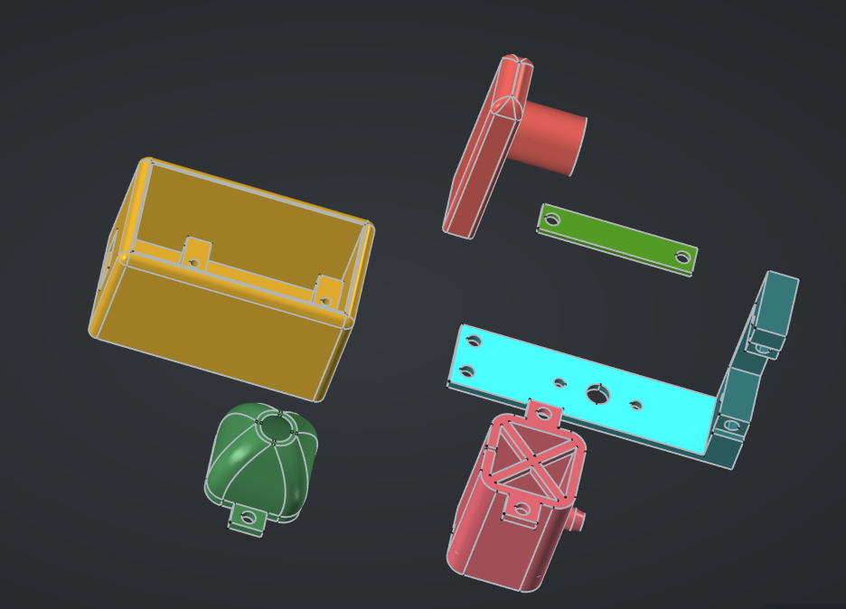

# MovingHead DIY

This is a DIY Moving Head project using an ESP32, servos, and RGB LEDs. The project allows you to control the position of the servos and the color of the LEDs via WebSocket or UDP.

## Requirements

You will need vscode w/ PlatformIO installed to build and upload the code to your ESP32.
A 3D Printer is recommended to print the parts, but you can also print the parts online.
You can find the 3D models on [Printables](https://www.printables.com/model/1362122-diy-moving-head-led-beam-light) or see last version (might be unstable / broken) in hardware/MovingHead.FCStd (FreeCAD Project).

Circuit:
ESP32 Or any compatible board (might need to change pin numbers in the code & PlatformIO project)

- 2 Servos (one for the base and one for the top) Recommended: MG90D / SG90, the model currently only supports MG90D, (parametric reconstruction currently in progress...)
- 1 RGB Led: 3W-9W
- 3 Led Drivers

> [!NOTE]
> An appropriate power supply (like 5V 3A) is needed as servos can draw significant power, using all of the esp32's power. This can also be mitigated by adding capacitors on 5V and 3.3V power rails.

A LED Driver rated for ~300mA-1.5A is available at `hardware/ProPrj_LEDDriver_2026-10-25.epro2`, it's currently an Easy EDA project, but will be replaced by a KiCAD one soon...

## Usage

1. Create the file `firmware/include/SECRETS.h` following the example in `firmware/include/SECRETS.h.example` to define your WiFi credentials and OTA settings.
2. Use `firmware/include/SETTINGS.h` to define GPIOs, and ports.
3. Upload the code to your ESP32 using PlatformIO.
4. Find your ESP32's IP using serial or your router, you can find your pins and test controls on `http://<your-esp32-ip>:80/`. To do updates, go to `http://<your-esp32-ip>:80/update` and use platform io's Build and Build filesystem to compile `firmware.bin` and `littlefs.bin` which you can then upload one after the other.
5. Print the 3D models and assemble the moving head.

You can use  to create light shows and control the moving head depending of the current music.

## Custom control

1. You can now open a WebSocket connection to `ws://<your-esp32-ip>:<port>/ws` to control the servos and LEDs. Port is defined in `src/SETTINGS.h` (default is 80).
2. Use the WebSocket client to send commands to control the servos and LEDs.
3. Use docs/protocole.md for messages reference.
4. If the message is correct, the server will reply `applied.` else `format error.`
5. You can also send UDP packets using the same technique.

## Thanks:

To entuland (361799048111325184) on FreeCAD's discord server for it's help for modeling the complex curves.

## AI Policy

In this project like every one I create, code is handwritten and hand-reviewed. AI must strictly be used as a tool, not as a replacment for your brain. AI Use cases:

- Explaining the code base
- Help for architectural decisions: which pattern to use
- Find TODOs and give snippet of example code.
- Help for Libs' usage.

What it musn't be used for:

- Full AI Commit with no review
- Full architectural decisions without thinking about alternatives
- Code you don't know how it works.
